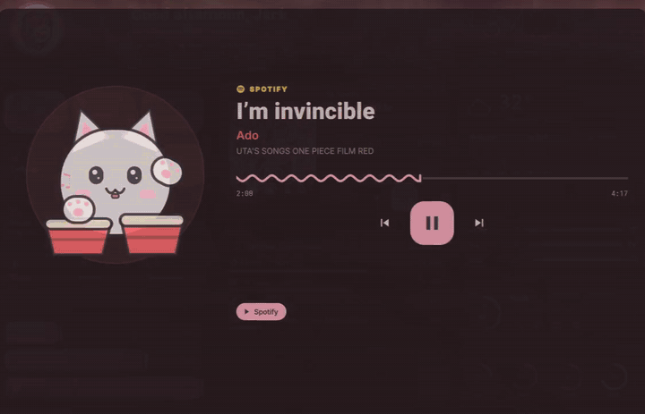
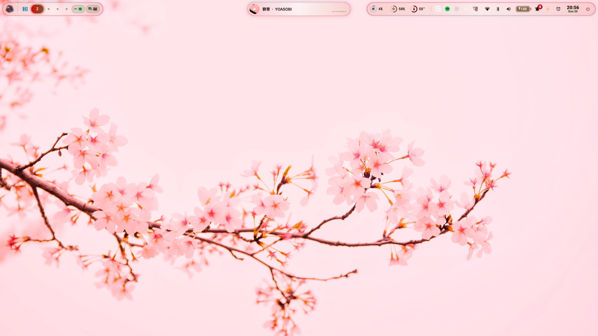
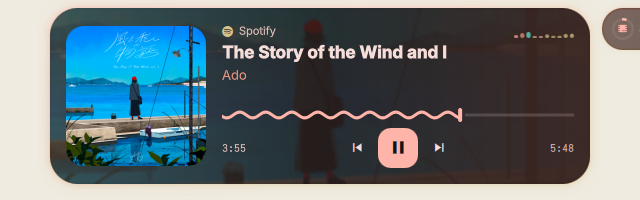
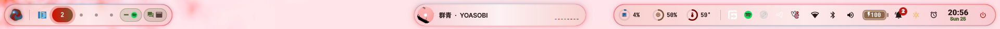
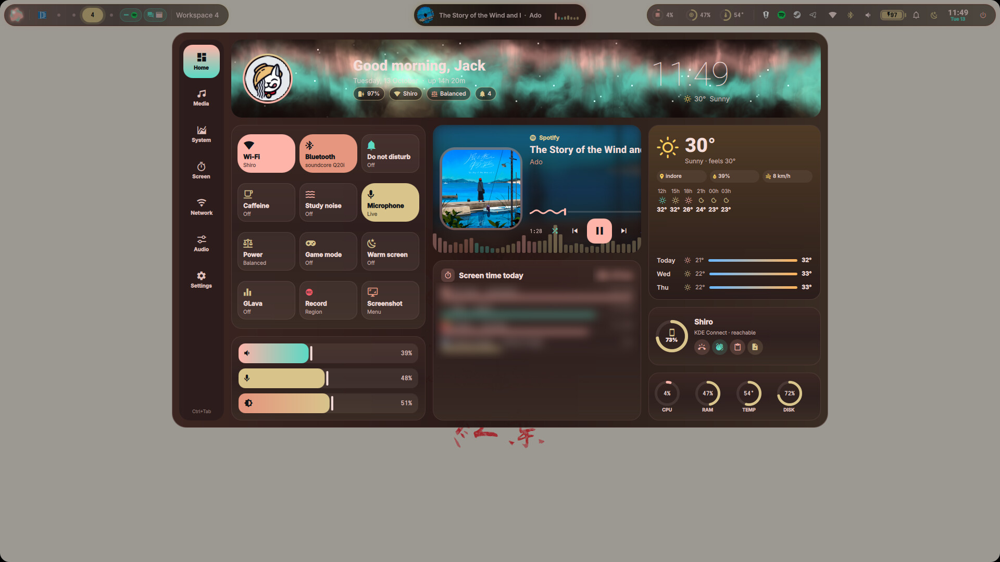
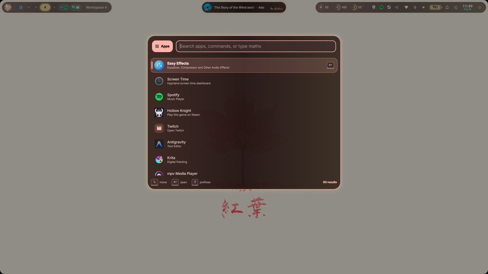
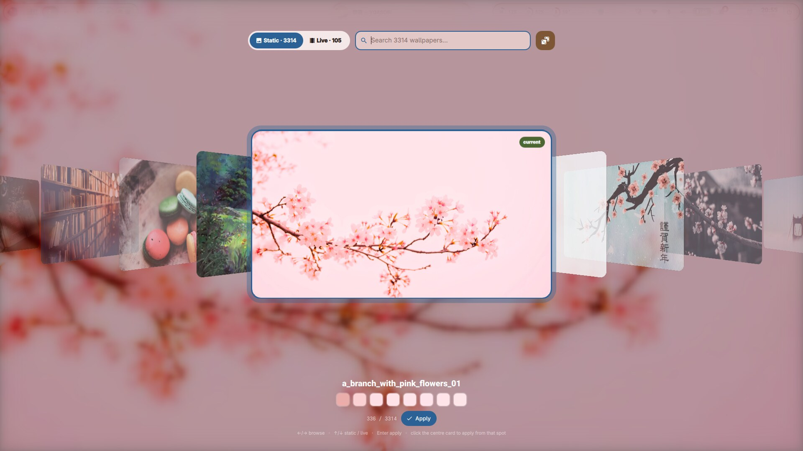
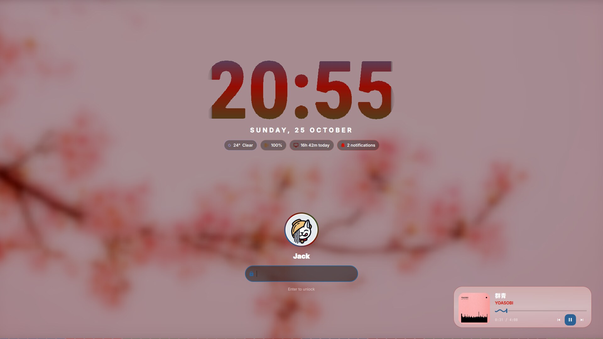

# Prism

**A Quickshell desktop shell for Hyprland.** The colours come from your wallpaper and everything moves.

<p align="center">
  <a href="assets/prism-demo.mp4"></a>
  <br>
  <a href="assets/prism-demo.mp4"><b>▶ Watch the 48-second tour (with sound)</b></a>
</p>



Prism replaces your bar, launcher, notification daemon, OSDs, lock screen and power menu with one
shell. Pick a wallpaper and [matugen](https://github.com/InioX/matugen) recolours all of it. The
palette cross-fades instead of snapping.

<p align="center">
  
</p>



## Screenshots

| | |
| :---: | :---: |
|  |  |
| **Dashboard**: toggles, media, weather, screen time, phone | **Launcher**: apps, commands, clipboard, emoji, maths |
|  |  |
| **Wallpapers**: coverflow picker that recolours everything | **Lock screen** |

The [tour](assets/prism-demo.mp4) shows the rest: the bongo cat, overview, drawers, clock and power menu.

## Features

- **Bar**
  - Plasma-orb launcher button.
  - Liquid workspace indicator with app icons, plus chips for special workspaces.
  - Live CPU, RAM and temperature rings, system tray, battery capsule and clock.
  - Dynamic island in the middle that morphs between:
    - clock and weather
    - now playing, with a cava visualizer
    - volume and brightness OSD
    - incoming notifications (with action buttons)
- **Edge drawers**: drag from the left edge for sliders and quick toggles, or from the right edge for
  notification history, a calendar and do-not-disturb.
- **Launcher** with modes:
  - apps
  - `/` commands
  - `@` open windows
  - `>` clipboard history (with image previews)
  - `:` emoji
  - `=` calculator
  - `$` shell
  - `#` web search
  - `y ` YouTube
  - `w ` wallpapers
  - `?` help
- **Dashboard** with tabs: Home, Media (a bongo cat drumming to the beat over a live visualizer), System (CPU / GPU / memory / disks / processes),
  Screen time, Network (Wi-Fi + Bluetooth), Audio (per-app mixer, mic meter) and Settings.
- **Workspace overview** with live window previews:
  - drag windows between workspaces
  - keys `1`–`0` jump to workspaces
  - `Space` shows minimised windows
- **Window switcher** with live previews.
- **Wallpaper picker**: a coverflow carousel where the transition grows from where you clicked.
  - Video wallpapers via mpvpaper.
  - Light/dark mode and colour-scheme picker (the whole system follows).
- **Capture**: screenshot (region / window / screen) and screen-recording menus.
- **Session**: lock screen, polkit agent, power menu.
- **Clock**: a floating window, written in Python, for timer, stopwatch (laps) and alarms (repeat days,
  snooze). You pick the alarm tone: built-in tones, system sounds or your own file. It can be pinned
  to every workspace or kept on one, and shrinks to a mini pill that shows whatever is counting. It
  keeps time in the background, and the bar shows what's running. Open it from the alarm button
  next to the bar clock, by right-clicking the clock, or with `SUPER + ALT + K`.
- **Extras**:
  - Pomodoro focus timer with study noise
  - 20-20-20 eye-break reminders
  - caffeine, game mode, warm screen
  - EasyEffects on/off
  - KDE Connect phone card
  - weather
  - a keybind cheatsheet generated from *your* Hyprland config

## Requirements

- **Arch Linux, or a distro based on it.** A fresh install with no desktop at all is fine; the
  installer sets up the whole desktop.
- **A normal user with sudo**, and an internet connection (`nmtui` or `iwctl` to get online).

## Install

Log in on the console and run:

```sh
bash <(curl -fsSL https://raw.githubusercontent.com/Jack02134x/prism-shell/main/install.sh)
```

Or clone it first:

```sh
git clone https://github.com/Jack02134x/prism-shell ~/.config/quickshell
~/.config/quickshell/install.sh
```

Answer the questions; pressing Enter takes the default every time. At the end it offers to start
Hyprland. From then on, Hyprland starts by itself when you log in on tty1.

> Try `--dry-run` first if you want to see every command without running anything.

### What the installer does

It asks before each step. It never deletes your files: anything it changes is backed up
(`*.bak-prism-<date>`), and each edit to your own files sits between `>>> prism >>>` markers so
`--uninstall` can take it back out.

| Step | What happens |
| --- | --- |
| **Checks** | Arch, not root, internet. |
| **Packages** | One `pacman -Syu` transaction installs:<br>- **Desktop:** Hyprland and its portals, polkit agent, PipeWire, NetworkManager, Bluetooth, kitty, Thunar.<br>- **Shell:** Quickshell, matugen, awww, cava, grim/slurp, wf-recorder, cliphist, hyprlock.<br>- **Looks:** every font and icon theme the shell uses (Nerd Font symbols, JetBrains Mono Nerd, Roboto, Adwaita, Noto + emoji + CJK, Breeze, Papirus, adw-gtk3).<br><br>It builds **yay** if you have no AUR helper, then offers the extras: Firefox (when you have no browser), EasyEffects, KDE Connect, mpvpaper, GLava and ani-cli. It also enables NetworkManager, bluetooth and power-profiles-daemon. |
| **Shell** | Copies Prism to `~/.config/quickshell` and backs up an existing config. |
| **`config.json`** | Fills in your name, terminal, file manager, editor and browser. |
| **Hyprland** | If you have no config, or Hyprland's untouched default, it installs a full starter `hyprland.lua`: layout, animations, blur, gestures, window rules, keybinds, your keyboard layout, and borders coloured from the wallpaper. If you already have your own config, it stays as it is. Either way, one marked block at the end loads Prism's autostart (`hypr/prism.lua`) and keybinds (`hypr/prism-binds.lua`). |
| **Idle** | Built into Prism, so no hypridle: it dims at 3 min, locks at 4 and turns the screens off at 5. Playing media, caffeine and fullscreen video keep the screen awake, and it locks before the laptop sleeps. Change the times in Dashboard → Settings. A running hypridle is offered for removal; while it runs, Prism's idle steps aside. |
| **Apps** | kitty (JetBrains Mono, translucent) and GTK apps (adw-gtk3 + Papirus) take their colours from the wallpaper. |
| **matugen** | One marked block in `~/.config/matugen/config.toml`. Every wallpaper change then recolours Prism, the window borders, kitty and GTK. Your own templates keep working. |
| **Wallpapers** | Copies 10 wallpapers into `~/Pictures/Wallpapers` and makes the first palette from one of them. |
| **Login** | Starts Hyprland when you log in on tty1 (bash, zsh or fish). This is skipped if you use a display manager. |
| **Conflicts** | Finds waybar, mako, dunst, swaync, hyprpaper and similar, and offers to stop them. |

Options:

| Option | Effect |
| --- | --- |
| `--dry-run` | Show every command, change nothing. |
| `--yes` | Accept every default without asking. |
| `--no-packages` | Skip the package step. |
| `--no-hypr` | Leave `~/.config/hypr` alone. |
| `--no-binds` | Load Prism's autostart but not its keybinds. |
| `--no-apps` | Don't theme kitty or GTK. |
| `--no-login` | Don't start Hyprland on tty1. |
| `--no-start` | Don't start anything at the end. |
| `--uninstall` | Take it all back out (packages stay installed). |

The log is written to `~/.cache/prism-install.log`. Hyprland won't start? Log in on tty2
(Ctrl + Alt + F2) and look at `~/.local/share/hyprland/hyprland.log`, or reinstall with `--no-login`.

## Keybinds

Press `SUPER + /` for the full cheatsheet. It is generated from your config, so it is always
current.

**Prism** (`hypr/prism-binds.lua`). This file loads last, so its keys replace whatever they did
before:

| Keys | Action |
| --- | --- |
| `SUPER + S` | Launcher |
| `SUPER + Escape` / `SUPER + SHIFT + Escape` | Dashboard / control drawer |
| `SUPER + N` | Notification centre (`SUPER + CTRL + N` clears it) |
| `SUPER + V` / `SUPER + .` | Clipboard / emoji |
| `SUPER + W` / `SUPER + SHIFT + W` | Wallpaper picker / random wallpaper |
| `SUPER + O` / `SUPER + SHIFT + TAB` | Workspace overview / window switcher |
| `Print`, `SHIFT`/`CTRL`/`ALT + Print` | Screenshot menu, region, screen, window (`SUPER + ALT + P` also opens the menu) |
| `SUPER + ALT + R` / `SUPER + SHIFT + ALT + R` | Recording menu / stop recording |
| `SUPER + ALT + Space` / `SUPER + SHIFT + Space` | Minimise window / show minimised |
| `SUPER + ALT + T` · `F` · `N` · `C` · `G` · `E` | Light/dark · focus timer · do not disturb · caffeine · game mode · EasyEffects |
| `SUPER + SHIFT + Q` | Quick-edit folders |
| `SUPER + L` / `SUPER + M` / `SUPER + /` | Lock / power menu / cheatsheet |
| Media keys | Volume, brightness and playback, with the island OSD |

**Windows**, from the starter `hyprland.lua`:

| Keys | Action |
| --- | --- |
| `SUPER + Q` or `Return` | Terminal |
| `SUPER + E` / `SUPER + B` | Files / browser |
| `SUPER + D` (`+ SHIFT` to force) | Close window |
| `SUPER + F` / `T` / `SHIFT + T` | Fullscreen / float / centre |
| `SUPER + J` / `P` / `G` | Split direction / pseudotile / group |
| `SUPER + arrows` (`+ SHIFT` to move) | Focus / move windows |
| `SUPER + 1…0` (`+ SHIFT` to send a window) | Workspaces |
| `SUPER + Z` (`+ SHIFT` to send a window) | Scratchpad |
| `SUPER + drag` (left button / right button) | Move / resize |
| 3-finger swipe | Switch workspace |

Every Prism action is also a command, for example `qs ipc call dashboard toggle`.
[action_commands.md](action_commands.md) lists them all.

## Configuration

Settings live in `~/.config/quickshell/config.json`. Most of them are also in **Dashboard → Settings**,
and both apply live. Useful keys:

- `bar.workspaces`, `bar.specials`: how many workspaces to show, and which special workspaces get
  chips (default `["minimize", "magic"]`).
- `wallpaper.dir`, `wallpaper.mode` (`dark` / `light`), `wallpaper.scheme`: where wallpapers live and
  how matugen builds the palette.
- `wallpaper.liveGpu`: which GPU plays live (video) wallpapers. `"auto"` uses the discrete GPU on
  hybrid laptops (NVIDIA through PRIME offload, AMD through `DRI_PRIME`); `"integrated"` always uses
  the main one.
- `lock.enabled`: use Prism's lock screen (PAM via `/etc/pam.d/hyprlock`). Otherwise `hyprlock` runs.
- `paths.extraBinds`: a second bind file for the cheatsheet (the installer points it at `hypr/prism-binds.lua`).
- `notifications.server`: set to `false` if you'd rather keep swaync, mako or dunst.
- `polkit.enabled`: use Prism's polkit agent instead of hyprpolkitagent. Stop the other agent first.
- `fx.*`: ambient animation, rounded screen corners, top-left hot corner.

To theme other apps too (GTK, kitty, Hyprland borders, …), add more templates to
`~/.config/matugen/config.toml`. Prism's template runs alongside them.

## Hyprland without the installer

Add this to the end of `hyprland.lua`:

```lua
dofile(os.getenv("HOME") .. "/.config/quickshell/hypr/prism.lua")        -- autostart
dofile(os.getenv("HOME") .. "/.config/quickshell/hypr/prism-binds.lua")  -- keybinds (optional)
```

Then add the templates from `matugen/` to your `~/.config/matugen/config.toml`. For example:

```toml
[templates.prism]
input_path = '~/.config/quickshell/matugen/prism-colors.lua'
output_path = '~/.config/quickshell/.state/colors.lua'
```

Prism dispatches through Hyprland's Lua API (`hl.dsp.*`), so it needs Hyprland 0.55+ with
`hyprland.lua`. The old `hyprland.conf` format isn't supported.

## Updating and removing

```sh
cd ~/.config/quickshell && git pull && ./install.sh   # update; keeps config.json, palette and your edits
~/.config/quickshell/install.sh --uninstall            # take Prism back out
```

## Troubleshooting

- **Something looks wrong:** run `qs log`. It prints the shell's warnings and errors.
- **Colours never change:** check that `~/.config/quickshell/.state/colors.lua` exists. Then run
  `matugen image <wallpaper>` and look for errors.
- **Two sets of notifications:** another notification daemon is running. Stop it, or set
  `notifications.server` to `false`.
- **Hybrid laptop (Intel/AMD + NVIDIA):** Quickshell renders on the integrated GPU, but the
  graphics loader still loads NVIDIA's libraries first (about 60 MB). Start it with
  `__EGL_VENDOR_LIBRARY_FILENAMES=/usr/share/glvnd/egl_vendor.d/50_mesa.json quickshell` to skip
  them. Don't do this if NVIDIA is your only GPU.
- **Icons show as boxes:** install `ttf-nerd-fonts-symbols` and run `fc-cache -f`.

## Credits

Built on [Quickshell](https://quickshell.org). Also uses [matugen](https://github.com/InioX/matugen),
awww, [cava](https://github.com/karlstav/cava),
[cliphist](https://github.com/sentriz/cliphist), Material Design Icons via Nerd Fonts, and the
Hyprland ecosystem.

The bundled wallpapers belong to their original artists. They're included so a fresh install
looks right; open an issue if one is yours and you'd like it credited or removed.
